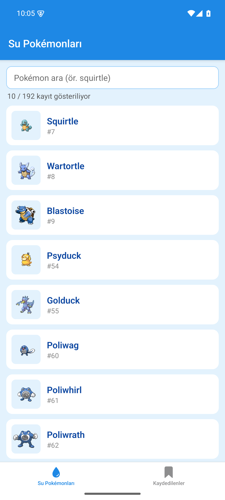
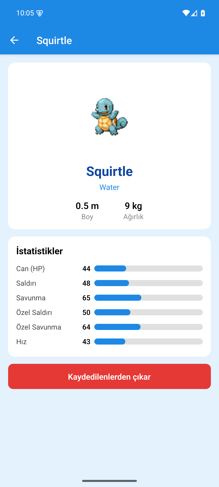
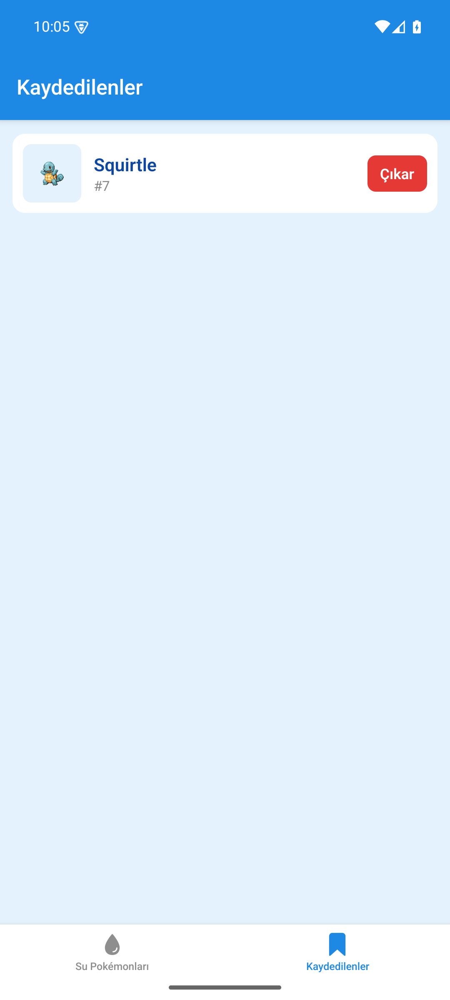

# Su Pokédex · BSM447 Dönem Ödevi

React Native + Expo ile yazılmış, üç ekranlı (Liste → Detay → Kaydedilenler) mobil uygulama.

| | |
|---|---|
| **Ad Soyad** | Samet Alıcı |
| **Öğrenci no** | G221210004 |
| **Konu** | K19 · Pokédex (PokeAPI) |
| **Varyant** | b · Su — `https://pokeapi.co/api/v2/type/water` |
| **Ek kural** | 6 · 10'ar 10'ar gösterme |
| **Kalıcı veri yöntemi** | AsyncStorage (`@react-native-async-storage/async-storage`) |

## Özellikler

- **Liste:** Su türündeki Pokémon'lar uygulama çalışırken PokeAPI'den `fetch` + `useEffect` ile çekilir ve `FlatList` ile gösterilir (`keyExtractor` = `name`). Üstteki arama kutusu büyük/küçük harfe duyarsız süzer.
- **Ek kural 6 – 10'ar 10'ar gösterme:** İlk 10 kayıt görünür; listenin sonuna kaydırınca ya da **"Daha fazla"** düğmesine basınca 10 kayıt daha eklenir. Arama değişince yeniden ilk 10 kayıttan başlanır.
- **Detay:** Kayıt `route.params` ile gelir; ikinci istek `pokemon/{name}` ile resim, boy, ağırlık ve istatistikler alınır. Her istatistik, değere bağlı genişlikte yatay bir çubukla gösterilir (en çok 150 = %100). "Kaydet / Kaydedilenlerden çıkar" düğmesi bu ekrandadır.
- **Kaydedilenler:** AsyncStorage'da saklanır; uygulama kapatılıp açılınca yerinde durur.
- Yükleniyor göstergesi ve internet yokken "Tekrar dene" düğmesi.
- **Navigasyon:** Bottom Tab (Liste, Kaydedilenler) + Native Stack (Detay sekmelerin üstünde açılır).

## Proje yapısı

```
App.js                      Navigasyon (Stack + Bottom Tab)
src/api.js                  PokeAPI istekleri ve yardımcı fonksiyonlar
src/SavedContext.js         Kaydedilenler + AsyncStorage
src/components/PokemonRow.js
src/screens/ListScreen.js
src/screens/DetailScreen.js
src/screens/SavedScreen.js
```

## Çalıştırma

```bash
npm install
npx expo start
```

APK: `eas build -p android --profile preview`

## Ekran görüntüleri

| Liste | Detay | Kaydedilenler |
|---|---|---|
|  |  |  |

## Bağlantılar

- **APK:** _(EAS build bağlantısı buraya)_
- **Ekran kaydı (≤ 1 dk):** _(video bağlantısı buraya)_
